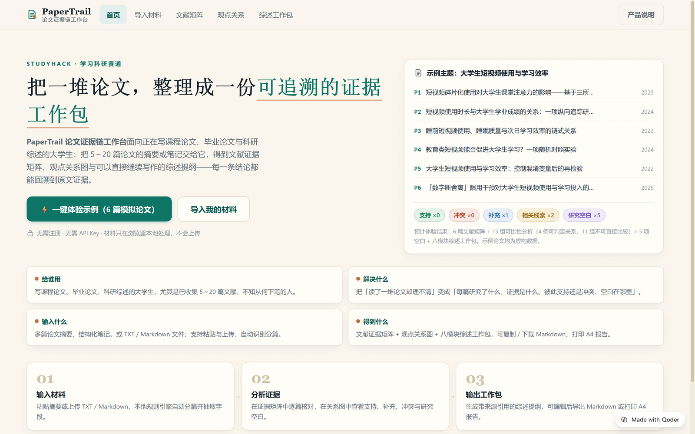
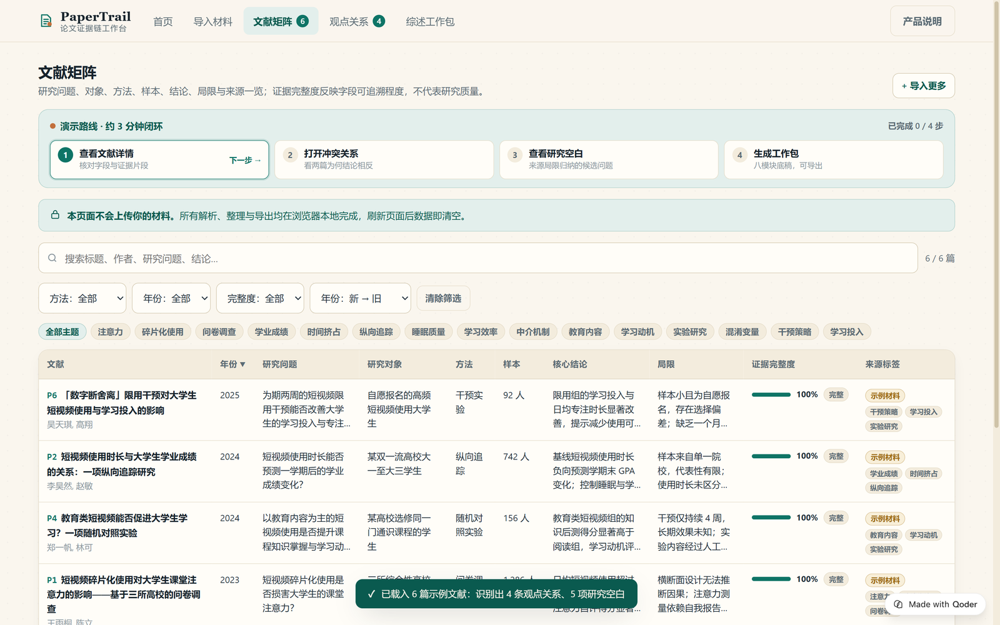
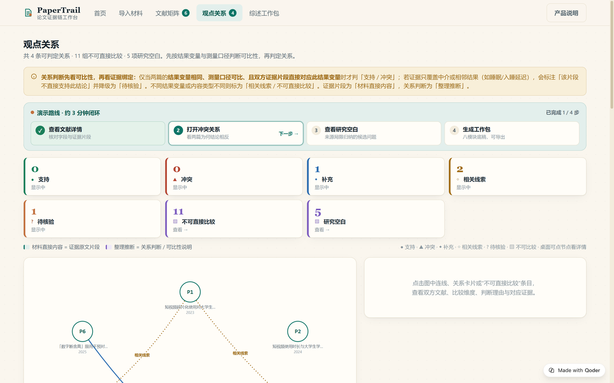
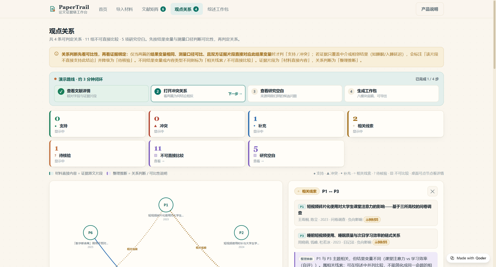
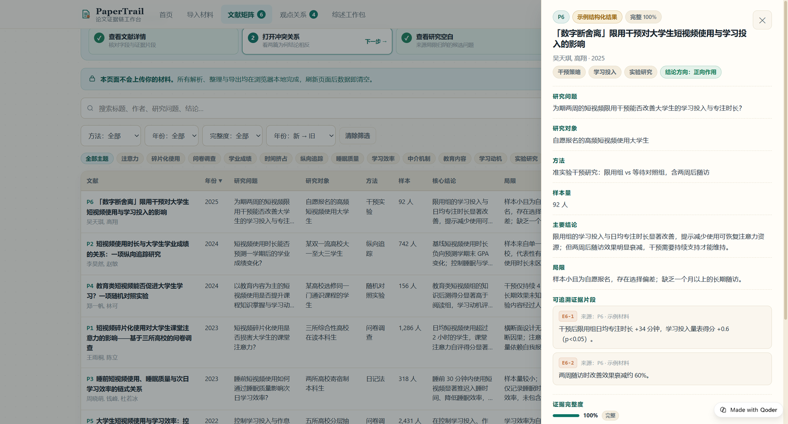
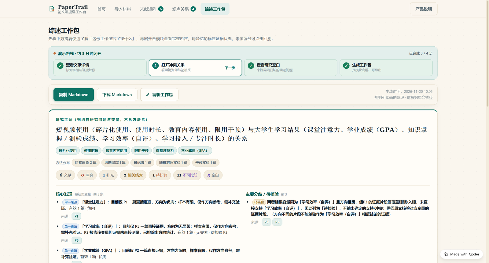
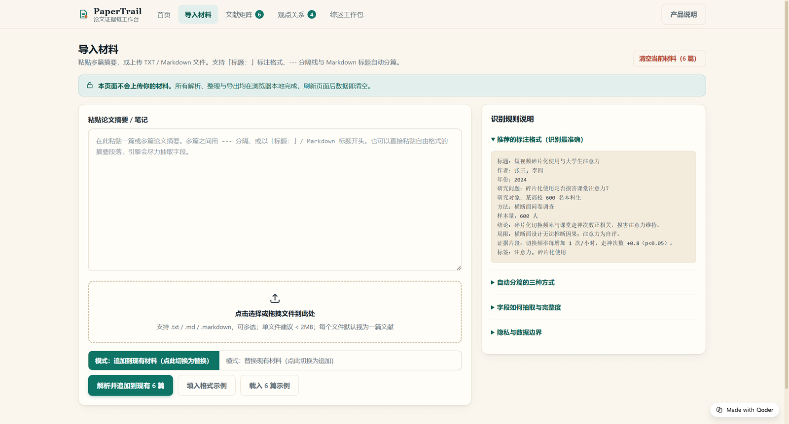
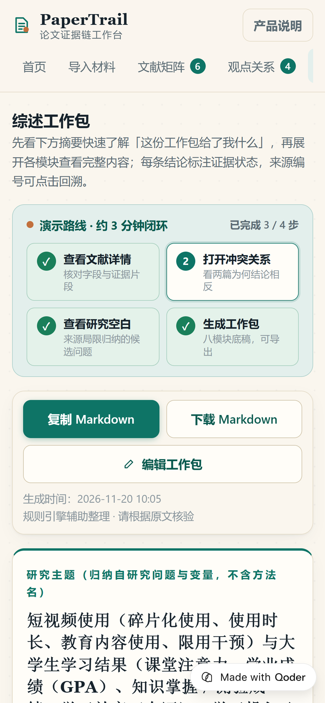

# PaperTrail · 论文证据链工作台

**把一堆论文变成一份可追溯的证据链。**

面向大学生课程论文、毕业论文和文献综述：把多篇论文摘要整理成一张文献矩阵，标出结论之间是支持、补充还是不可直接比较，列出研究空白，最后生成一份每条结论都带证据来源的综述工作包。

[**👉 在线体验**](https://paper-trail-4psq4mt50lx.qoder.zone) &nbsp;·&nbsp; [作品帖](https://tianchi.aliyun.com/forum/post/1102608) &nbsp;·&nbsp; 2026 Qoder 高校创造力大赛 · StudyHack 学习科研赛道



---

## 为什么做

写文献综述最耗时的不是读，是**对账**。

读了二十多篇，笔记散在几个 Word 文档里。等要写「已有研究表明……」这句时，得回头翻十分钟：这句话是哪几篇支持的？样本量多大？有没有人得出相反结论？

大模型能把这段写得很顺，但它是编的——它不告诉你依据是哪一篇、哪一段。**PaperTrail 不做「替你写」，它做的是把证据摆到台面上。**

每一句结论都能点回原文片段；两篇不能比的论文，它会明确告诉你为什么不能合并。

---

## 它长什么样

### 文献矩阵：一屏对照六篇的骨架

研究问题、研究对象、方法、样本量、核心结论、局限、证据完整度，七列并排。右侧的完整度条告诉你哪篇的证据链是齐全的、哪篇只有结论没有数据。



### 观点关系：不是「冲突」，是「不可直接比较」

关系判定有四档：支持、补充、冲突、待核验。但最容易出事的是第五档——**不可直接比较**。一篇测睡眠时长、一篇测测验成绩，方向相反，但根本不是一个东西；工具如果把它们算成「冲突」，你就写出了一个假争议。



点开卡片能看到判定理由：样本、方法、测量口径、时间范围哪一项对不上。



### 每条结论都能点回原文

文献详情抽屉里，结论字段旁边就是它在摘要里对应的那句话，不是模型生成的转述。



### 综述工作包：带证据状态的八模块

研究主题、跨材料共识、争议与待核验、方法差异、研究空白、可追问的问题、提纲、参考文献。每条结论后面标注「有效 N 篇 · 方向 · 来源」，没有直接证据时写「暂无直接证据」而不是猜。



导出支持复制 Markdown、下载 `.md`、A4 打印——打印出来的报告保留全部来源标注，可以直接交给导师看。

### 换成自己的材料

粘贴摘要或上传 `.txt` / `.md`，选「替换」或「追加」。重复材料会自动去重，示例和自己的混在一起时会标「N 篇示例 + M 篇导入」。



<p align="center">
  
</p>

---

## 三条设计原则

| 原则 | 具体做法 |
|---|---|
| **本地优先** | 解析、判定、生成全在浏览器里跑。不上传材料、不调外部 API、不写 localStorage。关上页面，什么都没留下 |
| **不编造** | 没有直接证据写「暂无直接证据」；只有一篇时写「单一来源」而不是给因果结论；两篇设计不同时标「并列结果」而不是合并成一个结论 |
| **可追溯** | 每条结论带来源编号，每项研究空白绑定来源文献的具体局限，导出和打印都不丢标注 |

---

## 怎么用（5 步）

1. 打开[线上地址](https://paper-trail-4psq4mt50lx.qoder.zone)，点首页「一键体验示例」，内置 6 篇「大学生短视频使用与学习效率」的模拟论文。
2. 看**文献矩阵**：六篇的字段并排，每行右侧是证据完整度。
3. 切到**观点关系**：能看到哪两组结论不能合并，点开卡片看判定理由。
4. 切到**综述工作包**：八个模块已生成，每条结论后标注证据状态。
5. 换成自己的材料：导入页粘贴摘要或上传文件，回到矩阵继续。

---

## 技术

原生 JavaScript，无框架、无构建步骤、无依赖。

```
web/
├── index.html
├── assets/style.css
├── js/
│   ├── app.js            视图调度与事件
│   ├── store.js          状态与导入去重
│   ├── views.js          四个视图的渲染
│   ├── core/
│   │   ├── parser.js     摘要解析：字段抽取、句子切分、立场识别
│   │   ├── engine.js     可判定性、关系推导、合成与空白识别
│   │   ├── exporter.js   Markdown / 打印输出
│   │   └── selftest.js   内置用例
│   └── data/samples.js   6 篇示例文献
tests/run-tests.mjs       23 条回归用例
tools/serve.mjs           本地静态服务器
docs/                     作品帖素材、验收口径、配图
```

```bash
node tools/serve.mjs 4173     # 打开 http://127.0.0.1:4173
node tests/run-tests.mjs      # 期望输出 23/23 通过
```

23 条用例覆盖的是真实踩过的坑，比如：

- `回归 U1/U2/U3：未测边界排除、不同设计为并列结果`
- `回归 U7/U8/U9：睡眠不入学习汇总、测验成绩不并入效率`
- `导出：示例证据标注「示例材料」，用户编辑不虚构来源`

---

## 开发方式

本项目由 **Qoder** 完成开发与部署。需求拆分、代码实现、多轮缺陷修复由 Qoder 执行；每轮改动后由人工独立复测——浏览器实测、DOM 断言、单元用例三条线同时跑，把测出的问题写成下一轮指令再交回 Qoder。

九轮迭代的指令留档在仓库根目录（`ROUND5-PROMPT.txt`、`ROUND8-PROMPT.txt`、`ROUND9-PROMPT.txt`）。

一条实测出来的经验：**AI 说「已修复」不等于修好了**。第 5 轮 Qoder 报告四项缺陷全部修复、测试 23/23 通过，但线上站点还是旧构建——本地改了 `views.js` 85648 字节，线上仍是 82786。后来每轮都加一步「`curl` 线上文件比对本地字节数」，才算真的收工。

---

## License

MIT